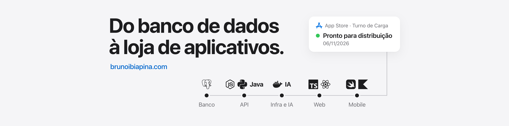

Desenvolvedor full-stack e mobile em Teresina, estudante de Engenharia de Software no iCEV (conclusão em dez/2027).
Construo produto de ponta a ponta: API, painel web, apps Android e iOS e a infraestrutura que mantém tudo no ar.

Uso IA como parte do método de trabalho: agentes que planejam, revisam código e conferem cada tela antes de eu publicar, sem abrir mão de teste e medição.

**Portfólio:** [brunoibiapina.com](https://brunoibiapina.com)  
**LinkedIn:** [in/brunoibiapina](https://www.linkedin.com/in/brunoibiapina/)

---

#### Em produção

| Projeto | O que é | Stack |
|---|---|---|
| **Papalegua** | Plataforma de entregas em Teresina, com mais de 1.000 pedidos por mês, 300+ empresas e 3.000+ entregadores cadastrados: app do cliente, app do entregador, painel do gestor e a API que decide status, repasse e cobrança | Laravel, MySQL, Kotlin, Swift, React, Docker |
| **[Nossas Viagens](https://apps.apple.com/app/id6825852602)** | App de viagens na App Store: roteiro dia a dia, reservas, gastos com câmbio e uma IA que monta o roteiro | React, Capacitor, Node, SQLite |
| **OpenCourt** | Gestão de torneios de tênis: inscrição, chaveamento, ranking e quadras | Next.js, Supabase, Postgres |
| **Ponteiros Premium** | Vitrine de relojoaria com painel do lojista, rodando na borda da Cloudflare | Next.js, Cloudflare D1/R2 |

O código desses produtos é privado. Telas, demonstrações e detalhes estão no [portfólio](https://brunoibiapina.com).

#### Engenharia e dados

- **Motor de xadrez em C++20**, feito em equipe para o Chess Challenge III do iCEV: bitboards, busca em paralelo, avaliação ajustada por Texel tuning e gestão de tempo própria. Nenhuma mudança entra sem medição em torneio automático.
- **[FluxVision](https://github.com/BrunoIbiapina/fluxvision)**: visão computacional que conta veículos em vídeo de câmera de rua (YOLO, RT-DETR).
- **[Bolão Pro](https://github.com/BrunoIbiapina/bolaopro)**: bolões com palpites, ranking ao vivo e PIX (NestJS, Prisma, Next.js). [Demonstração](https://bolaopro-eight.vercel.app).
- **[Findback](https://github.com/BrunoIbiapina/app-achadoseperdidos)**: app de achados e perdidos em Flutter.

#### Em construção

- **Achei**: app de promoções locais com um código só para iPhone, Android e web (Expo, React Native), API em Node com Fastify e PostgreSQL.
- **Cantina**: pedidos antecipados com API pura em Laravel e contrato OpenAPI, máquina de estados com 51 transições e 762 testes automatizados no backend.

#### Setor público

Desenvolvedor full-stack no Núcleo Estratégico de Tecnologia e Governo Digital do Piauí, no Visualizador de Processos do SEI, hoje em fase de testes na maioria dos órgãos do Estado: Next.js, FastAPI, PostgreSQL, Trino/Iceberg, Airflow e IA aplicada a processos.

#### Stack

- **Back-end:** PHP/Laravel, Node (NestJS, Fastify, Express), Python (FastAPI)
- **Front-end:** React, Next.js, TypeScript, Tailwind
- **Mobile:** Kotlin, Java, Swift, React Native/Expo, Flutter
- **Dados e infra:** MySQL, PostgreSQL, Redis, Docker, Cloudflare, DigitalOcean
- **Também:** C++, agentes de IA

---

**In English:** full-stack and mobile developer from Brazil, Software Engineering student. I ship products end to end (API, web, native Android/iOS, infrastructure) and use AI agents as part of a test-first workflow. Open to remote roles. English: beginner, currently studying.
